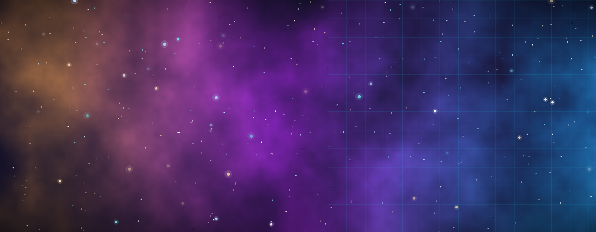
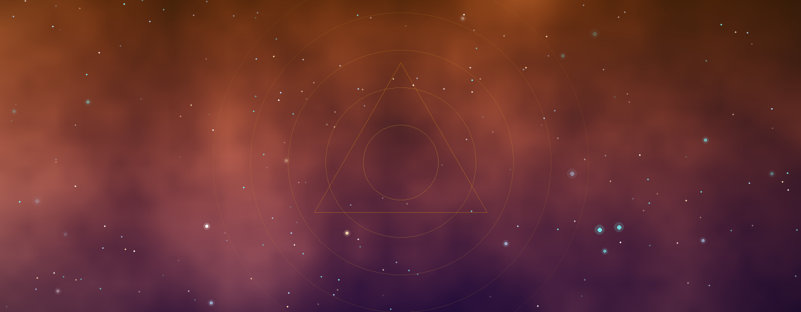
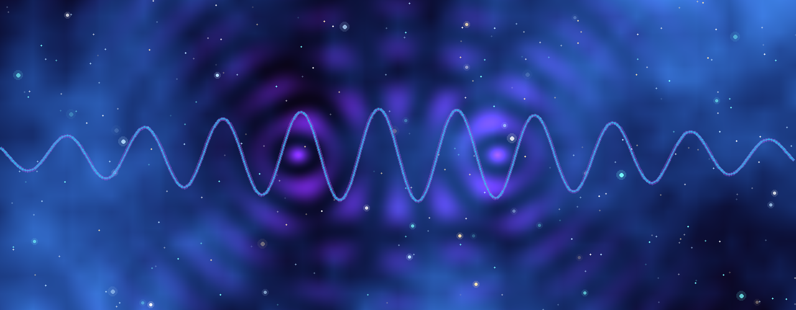
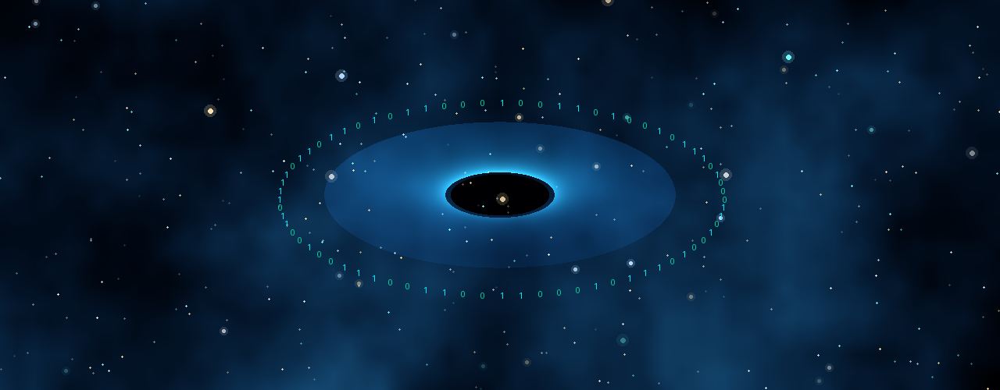
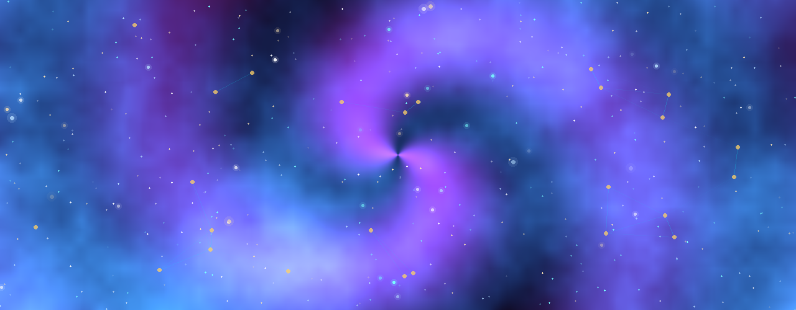
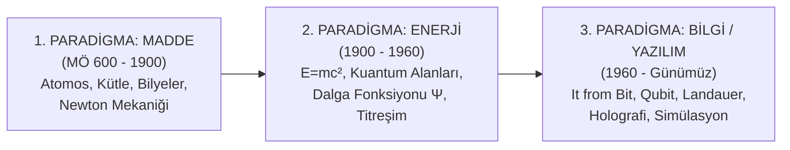

# 🌌 Evrenin Yapıtaşı: Maddeden Yazılıma (From Matter to Bit)

[](index.html)
[](cli/test_universe.py)
[](docs/)
[](LICENSE)

> *"Kozmos içimizdedir. Bizler yıldız tozundan yapıldık. Biz, evrenin kendini bilmesinin bir yoluyuz."*  
> — **Carl Sagan**

> *"It from bit. Bütün fiziksel nesneler, en temelde bilgi-teorik bir kökene sahiptir ve bu katılımcı bir evrendir."*  
> — **John Archibald Wheeler**

---

## 📖 Proje Hakkında

**"Evren neden ve neyden oluşuyor?"** sorusu, insanlığın 2600 yılı aşkın süredir yanıt aradığı en temel ontolojik ve fiziksel problemdir.

Bu proje; insanlığın evrenin temel yapıtaşlarına dair anlayışının **"Madde"** (Atom/Töz) paradigmasından **"Enerji ve Alanlar"** (Kuantum Alan Teorisi, $E=mc^2$) paradigmasına, son aşamada ise **"Bilgi ve Hesaplama"** (Dijital Fizik, *It from Bit*, Holografik Prensip, Simülasyon Hipotezi) aşamasına nasıl evrildiğini **8 canlı simülasyon laboratuvarı**, **24 kronolojik dönüm noktası**, **Kavram Sözlüğü**, **10 soruluk Kozmik Test**, matematiksel formüller, akademik makaleler ve Python hesaplama CLI'ı ile sistematik olarak sunan kapsamlı bir platformdur.

---

## 🎨 Görsel Galeri & Tematik Bannerlar

Portal genelinde yer alan 5 yüksek çözünürlüklü tematik görsel:

| 🌌 1. Maddeden Yazılıma Büyük Dönüşüm | 🏛️ 2. Antik Doğa Felsefesi & Arkhe |
| :---: | :---: |
|  |  |

| ⚛️ 3. Kuantum Alan Teorisi & Dalga Girişimi | 💾 4. It from Bit & Holografik Kara Delik |
| :---: | :---: |
|  |  |

| 🌐 5. Simüle Multiverse & Kuantum Hesaplama |
| :---: |
|  |

---

## 🏛️ Üç Büyük Ontolojik Devrim



---

## 🔬 8 İnteraktif Simülasyon Laboratuvarı

Web uygulamasında 8 adet gerçek zamanlı, canlı etkileşimli fizik ve enformasyon simülatörü yer almaktadır:

1. **Atom & Kuantum Orbitalleri Simülatörü:** Demokritos sert küresi, Bohr kuantum yörüngeleri ve Schrödinger kuantum olasılık bulutunun gerçek zamanlı görselleştirmesi ve foton soğurma/sıçrama tetikleyicisi.
2. **Kuantum Çift Yarık & Dalga Çöküşü:** Fotonların dalga girişimi ve gözlemci dedektörü açıldığında dalga fonksiyonunun parçacığa çöküş dinamiği.
3. **Konrad Zuse & Wolfram Hücresel Otomatı:** Kural 30 (kaos), Kural 110 (Evrensel Turing tam), Kural 90 (Sierpinski fraktalı) ve Kural 184 (akış dinamiği).
4. **Qubit & Bloch Küresi Simülatörü:** 3D Bloch küresi üzerinde süperpozisyon durum vektörü $|\Psi\rangle = \alpha|0\rangle + \beta|1\rangle$, Hadamard $H$, Pauli $X, Z$ kuantum mantık kapıları ve olasılık çubukları.
5. **Kara Delik & Holografik Hesaplayıcı:** Güneş kütleli, Cygnus X-1, Sagittarius A*, M87* ve TON 618 hazır şablonları; Schwarzschild yarıçapı, olay ufku alanı, Bekenstein-Hawking entropisi, Planck piksel sayısı ve Terabayt cinsinden bilgi depolama kapasitesi.
6. **Nick Bostrom Simülasyon Trilemması:** $f_p$ (post-insan çağı oranı) ve $N_I$ (ortalama simülasyon sayısı) parametrelerine bağlı olarak $P(\text{Sim}) = \frac{f_p N_I}{f_p N_I + 1}$ Bayesyen olasılık hesabı.
7. **Kuantum Dolanıklık ve Bell Eşitsizliği (EPR):** Alice ve Bob dedektör açılarının ($\theta_A, \theta_B$) kontrolü, kuantum korelasyonu $E(\theta_A, \theta_B) = -\cos(2(\theta_A - \theta_B))$ ve CHSH testiyle yerel gerçekçiliğin ihlali ($S = 2\sqrt{2} \approx 2.828 > 2$).
8. **Kozmik Ölçekler ve Seth Lloyd Bilgi Hiyerarşisi:** Planck ölçeğinden ($10^{-35}$ m) Gözlemlenebilir Evrene ($10^{26}$ m) fiziksel boyutlar, kütleler ve bilgi (Bit) kapasiteleri.

---

## 📊 Karşılaştırma Matrisi (Madde vs Enerji vs Bilgi)

| Boyut / Özellik | 1. Madde Paradigması | 2. Enerji & Alan Paradigması | 3. Bilgi Paradigması (It from Bit) |
| :--- | :--- | :--- | :--- |
| **Temel Ontoloji** | Bölünemez parçacıklar, katı bilyeler | Sürekli alanlar, dalgalanmalar, kuantlar | Ayrık bitler/qubitler, algoritmalar |
| **Temel Birim** | Kütle (kg / Dalton) | Joule / Kuantum ($E = h\nu$) | Bit (0/1) / Qubit ($|\Psi\rangle$) |
| **Korunum Yasası** | Kütlenin Korunumu (Lavoisier) | Enerjinin Korunumu ($E=mc^2$) | Bilginin Korunumu (Üniterlik) |
| **Uzay-Zaman** | Sabit, mutlak 3D sahne (Newton) | Dinamik eğrilen 4D manifold (Einstein) | Kuantum dolanıklık ağlarından türeyen hologram |
| **Kritik Denklem** | $F = ma$, $F = G \frac{m_1 m_2}{r^2}$ | $E = mc^2$, $\Delta x \Delta p \ge \hbar/2$ | $S = \frac{k_B A}{4\ell_P^2}$, $E_{\text{min}} \ge k_B T \ln 2$ |
| **Hız / İşlem Sınırı**| Sonlu mekanik hızlar | Işık Hızı ($c = 299,792,458\text{ m/s}$) | Margolus-Levitin ($R_{\text{max}} = \frac{2E}{\pi\hbar}$) |
| **Gözlemcinin Rolü**| Dışsal ve pasif seyirci | Çerçeveye bağlı (Lorentz bükülmesi) | Aktif katılımcı (Dalga çöküşü) |

---

## 💻 Python CLI Hesaplama Aracı

Terminalden hızlı fizik ve kozmoloji hesaplamaları yapmak için Python aracı hazırlanmıştır:

```bash
# İnteraktif CLI çalıştırma
python cli/universe_info.py

# Birim testleri çalıştırma
python cli/test_universe.py

# JSON çıktı alma
python cli/universe_info.py --json
```

---

## 📁 Proje Dosya Yapısı

```
evrenin-yapitasi/
├── index.html                   # Ana interaktif web portalı (8 Lab & Sözlük)
├── css/
│   └── style.css                # Modern kozmik glassmorphic tema & animasyonlar
├── js/
│   ├── physics.js               # Fizik, Bell CHSH ve simülasyon hesaplama motoru
│   ├── data.js                  # 24 Dönüm noktası, matris, sözlük & quiz veri tabanı
│   ├── audio.js                 # Web Audio API prosedürel kozmik ses sentezleyici (432Hz)
│   ├── canvas.js                # Arka plan kuantum parçacık ve ağ animasyonu
│   └── app.js                   # 8 Lab kontrolcüsü, sözlük, quiz ve dil yöneticisi
├── cli/
│   ├── universe_info.py         # Terminal CLI hesaplama aracı
│   └── test_universe.py         # Fizik denklemleri unit testleri
├── docs/
│   ├── 01_antik_cag_ve_arkhe.md                 # Antik felsefe ve Arkhe incelemesi
│   ├── 02_kuantum_mekanigi_ve_alan_teorisi.md   # Kuantum alanları ve Standart Model
│   ├── 03_dijital_fizik_ve_it_from_bit.md       # Dijital fizik, Landauer & Simülasyon
│   ├── 04_matematiksel_modeller_ve_formuller.md # Sabitler ve temel denklemler
│   ├── 05_kaynakca_ve_okuma_listesi.md          # Akademik kaynakça ve kitaplar
│   └── 06_kavram_sozlugu_ve_terimler.md         # Kapsamlı kavram sözlüğü
├── src/
│   ├── types/index.ts           # TypeScript arayüz ve tip tanımları
│   ├── utils/physics.ts         # TypeScript fizik hesaplama yardımcıları
│   └── data/timelineData.ts     # TypeScript veri tipleri
├── .github/workflows/
│   └── deploy.yml               # GitHub Actions CI/CD otomatik yayınlama
└── README.md                    # Proje dokümantasyonu
```

---

## 🚀 Çalıştırma

Projeyi çalıştırmak için herhangi bir sunucu kurmadan doğrudan `index.html` dosyasını tarayıcınızda açabilir veya yerel sunucu başlatabilirsiniz:
```bash
python -m http.server 3000
```
Tarayıcınızdan `http://localhost:3000` adresine gidin.

---

## 📜 Lisans

Bu proje [MIT Lisansı](LICENSE) altında açık kaynak olarak sunulmaktadır.